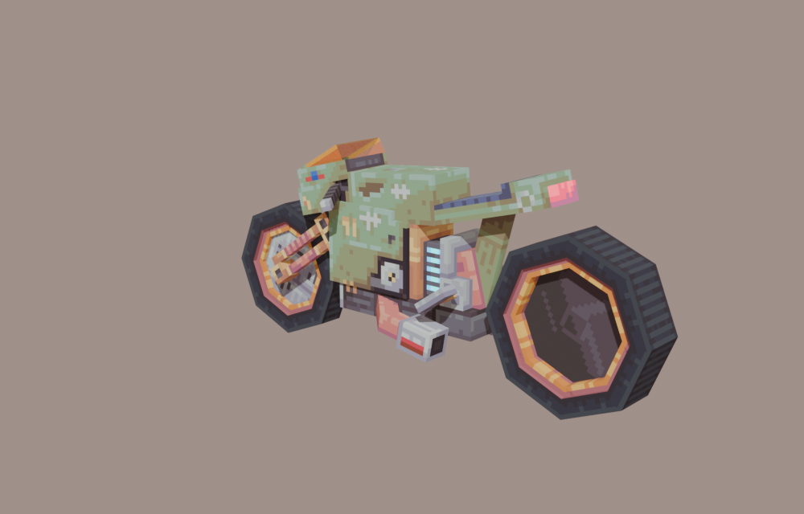
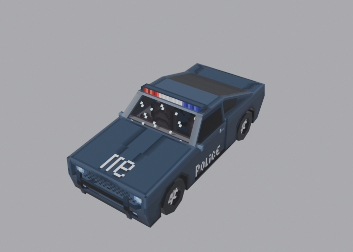
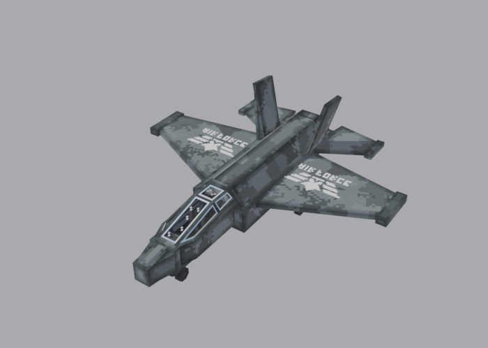
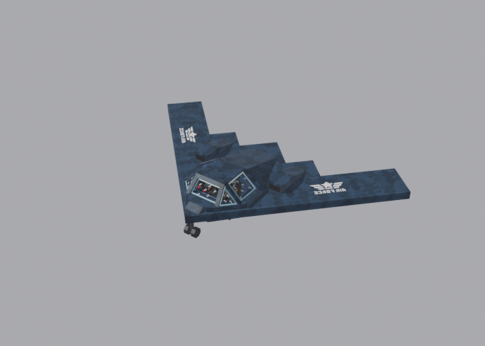
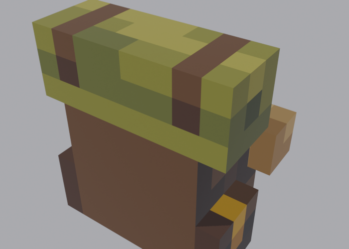

<div align="center">

# MODE HUD

**Минималистичный пиксельный худ для Minecraft — кровотечение, жажда, кислород и живые уведомления**

<br />


</div>

<br />


<br />

## О моде

MODE HUD заменяет стандартный интерфейс Minecraft на минималистичный пиксельный худ и добавляет к нему механики выживания. Хп, еда, вода и воздух выводятся компактными блоками, а всё важное, что происходит с игроком, показывается на экране: кровотечение, смена биома, вход в другое измерение, открытие портала.

Мод работает на **NeoForge 1.21.1**. Интерфейс нарисован нативно, без внешних библиотек и браузерных движков.

## Возможности

| Раздел | Что умеет | Где работает |
| --- | --- | --- |
| 🩸 **Кровотечение** | Три стадии, зависят от силы удара. Хп уходит раз в 4 / 2 / 0.8 секунды и игнорирует броню. Лёгкое кровотечение останавливается само, остальные — бинтом | Одиночная игра, сервер |
| 💧 **Жажда** | Шкала воды от 0 до 20: тратится со временем, быстрее при беге, в жарких биомах и в Незере. При 0 — урон по хп, при 4 и ниже — замедление | Одиночная игра, сервер |
| 🫁 **Кислород** | Строка воздуха плавно выезжает под водой и уезжает, когда лёгкие снова полны | Клиент |
| 🩹 **Лечение** | Таблетки возвращают 3 сердца, бинт останавливает кровотечение. Хп, потерянное от голода, жажды или удушья, восстанавливается само, когда причина устранена | Одиночная игра, сервер |
| 🧭 **Уведомления** | Биомы Верхнего мира, Незера и Края, подземелье и Глубокая тьма, начало путешествия, активация порталов, бой с Эндер-драконом. У каждого места свои символы и свой цвет | Клиент |
| 👁 **Открытие глаз** | После входа в мир и после возрождения экран чёрный, потом плавно открываются глаза | Клиент |
| 🎒 **Хотбар** | Карточки предметов без общей рамки: выбранная приподнята, остальные серые, панель сама уезжает вниз через 2 секунды | Клиент |
| 🏍 **Мотоцикл** | Транспорт на угле: заправка кликом по нему углём, двигатель заводится, когда садишься за руль. Поворачивается с наклоном в повороте и по склону, въезжает на ступеньку в 1 блок, на приборной панели показывается топливо | Одиночная игра, сервер |
| 💀 **Низкое хп и смерть** | Пиксельная кровь, красные края экрана, учащённое сердцебиение. После смерти шкалы падают до нуля и становятся серыми | Клиент |
| 🌧 **Погода на экране** | Капли дождя оседают на экране, у краёв гуще, и часть стекает вниз. Сила зависит от дождя и грозы. В пустыне и бэдлендсе вместо капель летит пыль, в снежных биомах тают снежинки. Под водой у краёв поднимаются пузырьки | Клиент |
| 🍃 **Частицы биомов** | В ясную погоду у краёв экрана падают листья, лепестки вишни, снег, песок, светлячки. В Незере летят искры, споры и пепел по биому, в Крае светятся фиолетовые искры | Клиент |
| 👣 **Следы и пар** | На снегу, песке, грязи, земле и траве остаются следы, цвет зависит от поверхности. В холодных биомах изо рта идёт пар | Клиент |
| ✈ **Самолёты** | Истребитель с пулемётом и ракетами и бомбардировщик «летающее крыло» с бомбами. Работают на угле, нужен разгон для взлёта | Одиночная игра, сервер |
| 🚗 **Машина** | Двухместная машина на угле с поворотом передних колёс и наклоном на склонах | Одиночная игра, сервер |
| 🎒 **Рюкзак** | Надевается на спину и виден на модели игрока, открывается клавишей, хранит 27 слотов, выпадает при смерти | Одиночная игра, сервер |
| 🕷 **Тарантул** | Большой паук с 220 хп. Появляется редко, вокруг него стая пауков и паутина. Быстро бегает, стреляет паутиной и замедляет игрока | Одиночная игра, сервер |
| 🌄 **Сглаженный рельеф** | В обычном мире перед ступенькой в 1 блок появляется полублок того же материала. Пещеры и постройки остаются как есть | Одиночная игра, сервер |

Погодные эффекты, следы, пар и уведомления показываются только в выживании. В творческом режиме и в режиме наблюдателя они выключены.

Дополнительно: всё настраивается через конфиги, размеры панелей меняются в настройках, русские и английские названия предметов.

## Предметы, транспорт и мобы


### Транспорт

Весь транспорт заправляется углём правым кликом, двигатель заводится, когда садишься, и расходует топливо. Шкала топлива показывается на экране.

| Мотоцикл | Машина |
| --- | --- |
|  |  |
| Один седок, наклоны в поворотах, въезжает на ступеньку в 1 блок | Два места, колёса поворачиваются и крутятся |

| Истребитель | Бомбардировщик |
| --- | --- |
|  |  |
| Левая кнопка мыши — пулемёт, правая — ракета | Левая и правая кнопки мыши сбрасывают бомбы |

**Управление самолётом.** Нужен разгон по земле, пока скорость ниже взлётной, самолёт не поднимется.

| Клавиша | Действие |
| --- | --- |
| Shift | Тяга вперёд |
| Ctrl | Тормоз и задний ход |
| S | Нос вверх |
| W | Нос вниз |
| A / D | Поворот влево и вправо |
| R | Выйти, только после посадки |

### Рюкзак



Правый клик с рюкзаком в руке надевает его на спину. Клавиши настраиваются в разделе управления игры.

| Клавиша | Действие |
| --- | --- |
| G | Открыть рюкзак |
| H | Снять рюкзак |

### Тарантул


Появляется в Верхнем мире вместе с обычными пауками, но гораздо реже, шанс задаётся в `modehud-common.toml`. Есть яйцо призыва во вкладке творческого режима.

### Полублоки рельефа

Одиннадцать полублоков (трава, земля, каменистая земля, подзол, мицелий, песок, красный песок, гравий, грязь, камень, глина) лежат в творческой вкладке и крафтятся из соответствующего блока, 3 блока дают 6 полублоков. Генерация ставит их сама перед каждой ступенькой в 1 блок, постройки и пещеры она не трогает.

## Установка

1. Установите **NeoForge 1.21.1** (версия 21.1.x).
2. Скачайте `modehud-0.1.0.jar` и положите в папку `mods` вашей игры.
3. Запустите игру.

Предметы мода лежат во вкладке творческого режима **Mode HUD** и крафтятся:

- **Бинт** — 1 белая шерсть (4 бинта) или 2 бумаги и нитка (2 бинта).
- **Мотоцикл** — 4 железных слитка, 2 чёрные шерсти и печь (узор: `II_`, `WFW`, `I_I`).
- **Таблетки** — сахар, костная мука и одуванчик, получается 3 таблетки.
- **Машина** — 3 железных слитка сверху, под ними железный блок, печь, железный блок, а снизу чёрная шерсть, слиток, чёрная шерсть (`III`, `BFB`, `WIW`).
- **Истребитель** — `ISI`, `BFB`, `III`: слитки, раздатчик, железные блоки и печь.
- **Бомбардировщик** — `BIB`, `IFI`, `TDT`: железные блоки, слитки, печь, динамит и раздатчик.
- **Рюкзак** — кожа, нитка и сундук (`LSL`, `LCL`, `LLL`).
- **Полублоки** — 3 блока в ряд дают 6 полублоков.

## Настройки

Файлы создаются после первого запуска в папке `config` игры.

| Файл | Что внутри |
| --- | --- |
| `modehud-client.toml` | Размеры худа и уведомлений, включение глаз, уведомлений, крови, погодных эффектов и символьных эффектов |
| `modehud-common.toml` | Скорость жажды, пороги и шансы кровотечения, интервалы потери хп, лечение таблетками, урон и взрывы самолётного оружия, редкость тарантула |

## Сборка

```bash
./gradlew build
```

Готовый файл появится в `build/libs/modehud-0.1.0.jar`. JDK 21 Gradle скачает сам.

### Обновление

Замените старый `jar` в папке `mods` новым, настройки сохранятся.

### Удаление

Удалите `modehud-*.jar` из папки `mods`.

<br />

<div align="center">

Сделано **ZEDKODEX**

</div>
